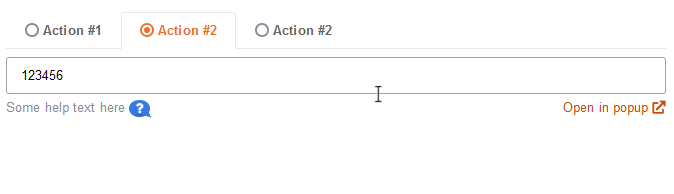

# BlockUI - block the whole page or any element

> Simple, useful and visually pleasing UX to respond to user interaction and indicate progress in the background.



### Usage:

Include jQuery & `blockui.min.js` into your page and:

```javascript
// one element:
$('.selector').block();
// or with optional message next to the spinner
$('.selector').block('Loading… <a href="">cancel</a>');
/* ➡️ */
$('.selector').unblock()

// full window:
$.blockUi();
/* ➡️ */
$.unblockUi()

// get status:
$('.selector').isBlocked()
$.isUiBlocked()
```

### How it works

Blocking adds the classes `block-ui-host` and `block-ui-blocked` to the element and appends one transparent
`div.block-ui-shield` that catches pointer events, shows the progress cursor and holds the spinner and the
message. 

The striped overlay is a CSS pseudo-element whose fade in/out is a CSS transition. Key input inside a
blocked element is swallowed by a single document-level listener. 

`block-ui-host` stays on the element after unblocking: it carries the (invisible) pseudo-elements, and a
pseudo-element can only fade out while it still exists.

This approach was chosen to not step on these edge-cases and have intuitive features:
1. jQuery clone() on a blocked element works without hitch.
2. Html is supported in the optional messages.
3. Clicks are blocked from triggering anything below the block element.
4. Blocked element nor anything within cannot be focused.
5. Visually it looks nice, has transitions, "loading" cursor.

### Caveats

- Elements that cannot have pseudo-elements (`img`, `input`, `select`, `textarea`, `iframe`, `video`,
  `audio`, `canvas`, `object`, `embed`, SVG) cannot be blocked: `block()` throws a JavaScript error. Block a
  wrapping element instead.
- On `unblock()` the spinner and the message disappear at once, only the striped overlay fades out.
- The element gets `position: relative` unless it is positioned already.

### Tests

`node test/run.mjs` runs `test/index.html` in headless Chrome (needs `google-chrome` on `PATH`).

Inspired by https://github.com/malsup/blockui

### Copyright

Do whatever you want with it.
